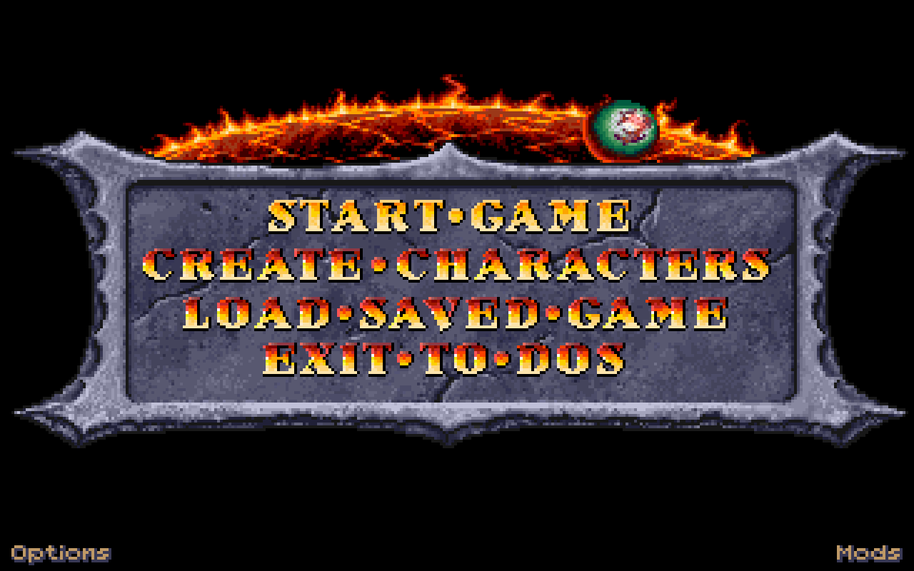
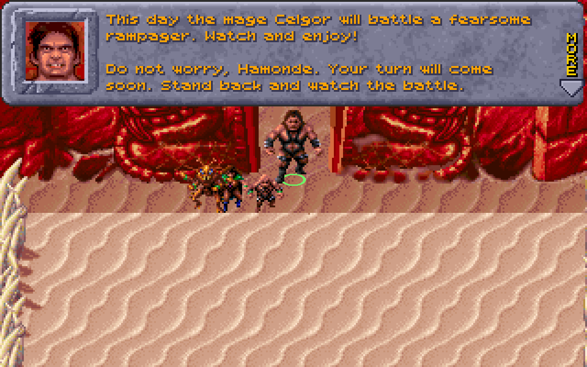
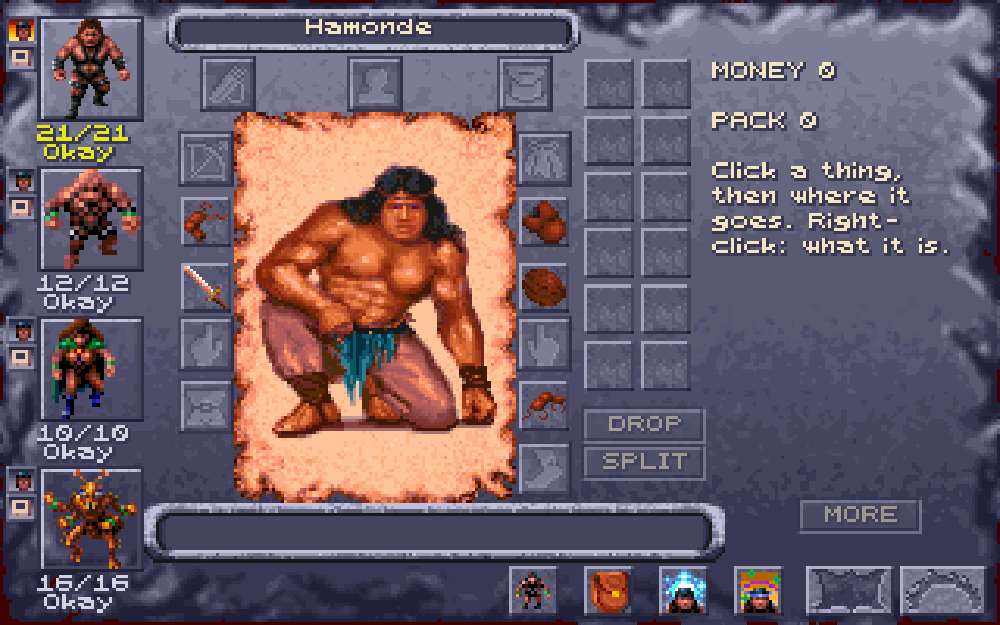
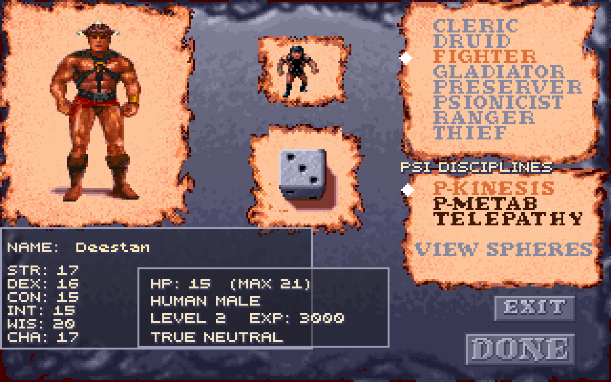
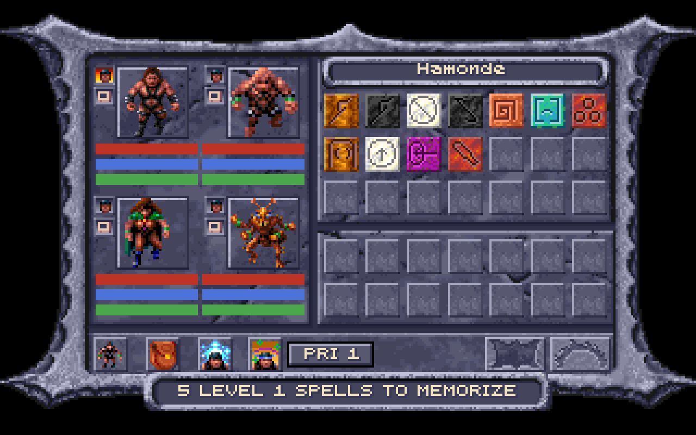

# yuan-ti

A new engine for **Dark Sun: Shattered Lands** (SSI, 1993), along with the
reverse-engineering toolkit used to build it.



The **Dark Sun Engine** is a rewrite of the original DOS game, built with
Godot 4 and C#. It runs on Linux, Windows and macOS. Its aims, in order:

- the game works and is easy to mod;
- it stays faithful to the original.

The engine contains none of the game's art, music or data. It reads them at
runtime from your own copy of Dark Sun, and never changes those files.

The repository also holds the tools the engine grew out of:
- a Python parser for SSI's GFF container format;
- a web viewer for the games' images, maps, music, scripts and data;
- a disassembler for the game's GPL scripting language;
- notes on the original executable, `DSUN.EXE`.

The tools also read *Dark Sun: Wake of the Ravager*, and partly *Al-Qadim: The Genie's Curse*.

### Region Node Map

Run `make serve` and choose **Regions** in the Python viewer to explore the
connections between maps. Arrows indicate possible party travel; select a node
to inspect incoming/outgoing connections and the script addresses behind them,
or open its rendered map. Scroll to zoom, drag the background to pan, and use
**Reset view** to see the whole graph.
The grid is centered on DS1's starting arena (region 42, `RGN2A.GFF`), with
connected regions placed outward from it. Connections run only horizontally
and vertically around nodes; two arrowheads indicate two-way travel.
Move/door trigger coordinates guide relative placement and cardinal edge choice,
carried through script calls to the party teleport. Broader exit zones take
priority when several triggers lead to the same map. Arrows always attach at
the center of the chosen edge, with the destination on the opposite edge;
when several links share an edge they spread out from its center.
Routing prioritizes fewer turns, then shorter paths that avoid other links,
while avoiding map nodes.
DS1's Sewers is placed above both Slave Pens and Fields of Draj; these cardinal
directions override ambiguous corner/stair trigger positions.
Placement is best-effort when the scripts imply conflicting spatial relationships.
DS1's Temple Ruins links to Teaquetzl, Wagon Train, Cedrilte and Gedron,
Teaquetzl–Korbnor, and Korbnor–White Sands are non-geographic: shown dashed
without constraining placement. These exceptions use region IDs, not editable
names. Region 255 remains visible separately as an unconnected test map.
Each node shows a server-rendered miniature of its map, with its name and
filename below. Previews preserve the whole map's aspect ratio and are cached
as small PNGs; the graph does not download full-size maps for its icons.
`/api/gff/<filename>/map-render?game=<game_id>&thumbnail=1` returns a preview
fitting within 192 x 112 pixels. Preview failures are shown on the node.
Select a region, enter a **Map name**, then choose **Save name**. Names appear
on nodes and in connection lists; GFF filenames remain visible. Clear the field
and save to restore the default region label. Names persist per game in
[`src/json/map_names.json`](src/json/map_names.json), without changing game files.
`GET` / `POST /api/gff/<filename>/map-name?game=<game_id>` reads/saves
`{"name":"Draj Arena"}`.

`GET /api/region-connections?game=dark_sun` (or `dark_sun_2`) supplies the graph.
It traces each region's `MAS` startup script through calls and registered
triggers, collecting party `TELEPORT` destinations. This is static analysis:
conditional routes are included, not guaranteed to be open, and dynamic
destinations or decoding gaps are reported under **Static analysis notes**.
Positions express connectivity, not geographic coordinates. Maps without
connections remain visible; destinations without installed maps are dashed.
Al-Qadim's LIB-based maps are not supported.
DS2 script decoding is currently incomplete, so its graph is partial.

Map PNGs are rendered on the server and saved automatically under
`precomputed/<game>/maps/rendered/`, including custom palettes. Repeat requests
reuse the PNG, and browsers revalidate it instead of forcing a fresh download.
Changed GFF files or renderer sources invalidate the cached render. To prepare
default map images in advance, use `make precompute-maps`.
Connection analysis is cached per game in memory and under
`precomputed/<game>/maps/connections/`; node positions and cardinal routes are
reused in the browser until connectivity changes.
Map names are read fresh, so editing names does not repeat script analysis
or graph routing. Rendered PNGs and connection analysis survive server restarts.

## Screenshots

| | |
|---|---|
|  |  |
| The arena in Draj, where a new game starts | The inventory |
|  |  |
| Creating a character | Memorizing spells |

## What works

- **The opening:** the intro and the arrival cinematic, with the original music.
- **Characters:**
  - creating characters;
  - the party screen.
- **Exploring:**
  - every region of the game;
  - its scripts, conversations, doors and traps;
  - the day's clock.
- **Fighting:** turn-based combat, including:
  - melee, missiles and spells;
  - psionics;
  - the original's AI for monsters.
- **Items:**
  - the inventory, with bags, chests and corpses that hold things;
  - money;
  - stores;
  - casting spells from wands, scrolls and fruit.
- **Saving and loading** games.
- **Mods:** they replace the game's images, text, sounds, scripts, items, monsters and window layouts with loose files (see [Mods](#mods)).
- **Quality-of-life additions:**
  - zoom;
  - a journal of every conversation;
  - a list of keys on every screen (press `?`);
  - a script debugger;
  - the option to repair the shipped scripts' known bugs;
  - shadows under the figures, dust where they walk on sand, and in a fight
    red rings under the enemies, with Tab to choose one and Enter to attack it
    (after the [Obsidian Edition](https://github.com/daaki85/darksun-obsidian-edition)).

It is a work in progress. The [roadmap](.github/instructions/dsun-rewrite-roadmap.md)
lists what's done and what's left.

## Installing

### 1. Get the original game

You need your own copy of *Dark Sun: Shattered Lands*. The
[GOG release](https://www.gog.com/game/dark_sun_shattered_lands) works. The engine needs the folder that holds
`GPLDATA.GFF`, `RESOURCE.GFF`, `SEGOBJEX.GFF` and the `RGNxx.GFF` region
files. That is the game's install folder, the one with `DSUN.EXE` in it.

### 2. Download the engine

Every merge to `main` publishes a build to
[Releases](https://github.com/CalvinRodo/yuan-ti/releases/latest). Download
the file for your system:

| System | File |
|--------|------|
| Linux (x86-64) | `DarkSunEngine-linux-x86_64.tar.gz` |
| Windows (x86-64) | `DarkSunEngine-windows-x86_64.zip` |
| macOS (Intel and Apple Silicon) | `DarkSunEngine-macos-universal.zip` |

The builds include .NET, so there's nothing else to install.

**Linux**

```sh
mkdir DarkSunEngine
tar -xzf DarkSunEngine-linux-x86_64.tar.gz -C DarkSunEngine
./DarkSunEngine/DarkSunEngine.x86_64
```

Keep `DarkSunEngine.x86_64` beside `DarkSunEngine.pck` and the
`data_DarkSunEngine_linuxbsd_x86_64` folder.

**Windows**

Unzip the archive to a folder of its own and run `DarkSunEngine.exe`.
Keep it beside the other files from the archive. The
build isn't signed, so SmartScreen may warn you about it. To run it anyway,
choose **More info**, then **Run anyway**.

**macOS**

Unzip the archive and move `Dark Sun Engine.app` to Applications. The app
isn't signed or notarized, so on the first start macOS refuses to open it.
Right-click the app and choose **Open**, or clear the quarantine flag:

```sh
xattr -dr com.apple.quarantine "/Applications/Dark Sun Engine.app"
```

### 3. Point it at the game

On the first start, the engine looks for the game files. If it can't find
them, it shows a start screen: choose **Choose game folder…** and pick the
folder from step 1. The engine remembers that folder.

You can also set the `DARKSUN_DIR` environment variable to the game folder:

```sh
DARKSUN_DIR="$HOME/GOG Games/Dark Sun Shattered Lands" ./DarkSunEngine.x86_64
```

### Music

The music is played through a General MIDI SoundFont (`.sf2`). The engine
looks for one, in order:

1. the `DARKSUN_SOUNDFONT` environment variable;
2. any `.sf2` in the game folder or the engine's user data folder;
3. the system's SoundFonts, such as `/usr/share/sounds/sf2` on Linux.

On Debian or Ubuntu, `sudo apt install fluid-soundfont-gm` installs a good
one. Without a SoundFont there is no music. Sound effects still play.

## Playing

Start Game plays the arrival cinematic and puts your party in the arena of
Draj, as in the original. Create Characters builds or changes the party
first.

| Key or click | What it does |
|--------------|--------------|
| `?` | Lists every key on the current screen |
| Click | Walk there, or use the pointer on what's there |
| Right-click | Change the pointer: move, attack, look |
| Arrow keys | Walk |
| `W` `A` `S` `D`, middle-drag | Scroll the map |
| Mouse wheel, `+` / `-` | Zoom |
| `Tab` | Select the next character |
| `I` / `C` | Inventory / character sheet |
| `J` | Journal |
| `O` | Options, including rebinding keys |
| `F5` / `F9` | Quick save / quick load |
| `Esc` | Back, or the game menu |

In a fight, `Q` casts a spell or uses a power, `G` guards, `T` waits, `E`
ends the turn, and `U` lets the computer fight for that member.

## Mods

A mod is a folder of loose files that replace the game's resources, for example:
- PNG images;
- text;
- WAV sounds;
- GPL scripts as source;
- JSON for items, monsters, music and window layouts.

The engine reads mods from these folders:
- a `mods` folder beside the game files;
- the `mods` folder in the engine's user data folder:
  - Linux: `~/.local/share/godot/app_userdata/Dark Sun Engine/mods`;
  - Windows: `%APPDATA%\Godot\app_userdata\Dark Sun Engine\mods`;
  - macOS: `~/Library/Application Support/Godot/app_userdata/Dark Sun Engine/mods`;
- the folder named in `DARKSUN_MODS`.

**Mods** on the main menu turns each mod on or off. The layout of a mod
folder is in the [engine README](engine/README.md#mods).

## Building from source

**Requirements:**
- [.NET 10 SDK](https://dotnet.microsoft.com/download);
- [Godot 4.7.2, .NET edition](https://godotengine.org/download);
- [uv](https://docs.astral.sh/uv/), for the Python tools.

```sh
make engine-build   # build the engine, its tools and tests
make engine-test    # unit tests
make engine-run     # run the game; GODOT=/path/to/godot if it isn't in ~/.local/opt
make engine-edit    # open the project in the Godot editor
make engine-export  # build the release packages into build/
```

`make help` lists every command. The [engine README](engine/README.md)
covers the rest:
- the code's layout;
- headless checks against the game files;
- command-line flags;
- how each part of the game was matched to the original.

### The toolkit and web viewer

```sh
uv sync      # install the Python dependencies
make serve   # the viewer at http://localhost:5000
```

The viewer browses every resource in the games' GFF files:
- images with their palettes;
- region maps with their objects;
- music and sound;
- cinematics;
- disassembled scripts;
- item, monster and spell tables.

It expects the games in `dark_sun/`, `dark_sun_2/` and `al-qadim/` at the
repository root. Those folders are not committed.

[AGENTS.md](AGENTS.md) describes the toolkit's architecture and the GFF
format. `.github/instructions/` holds the reverse-engineering notes on
`DSUN.EXE`.

## Credits

- **Dark Sun: Shattered Lands** © 1993 Strategic Simulations, Inc.
  *Dark Sun* and *Advanced Dungeons & Dragons* are trademarks of Wizards of
  the Coast. This project is not affiliated with or endorsed by them, and
  includes none of the game's files.
- The GFF format work builds on John Glassmyer's original Java tools, and
  cross-checks the libgff and soloscuro C implementations.
- The shadows, dust, enemy rings and Tab / Enter targeting follow the
  [Obsidian Edition](https://github.com/daaki85/darksun-obsidian-edition)'s,
  a mod for the original game.
- [OpenDS](https://github.com/VirInvictus/opends) documented many of the
  shipped scripts' bugs that the engine repairs.
- Music is synthesized with [MeltySynth](https://github.com/sinshu/meltysynth) (MIT).
